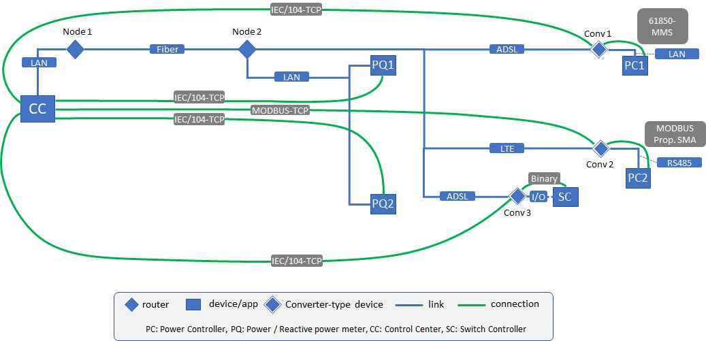

.. _elements:

##########################
Datastructure and Elements
##########################

A pandaict network consists of an element table for each ict element in the network. Each element table is a pandas DataFrame that stores parameters according to the datamodel. The full datamodel definition is found in this excel file: :download:`Datamodel.xlsx`

An example for creation of a simple pandaICT network is found in the sourcecode under test/core_test.py in function create_testnet1(). This creates the following network. 

.. |br| raw:: html

     
	
|br|
|br|
|br|
|br|
|br|
|br|
|br|
|br|
|br|
|br|
|br|
|br|

You can find detailed information about the creaation of elements in the following documentation:

.. toctree::
    :maxdepth: 1

    elements/identifier
    elements/net
    elements/node
    elements/link
    elements/device
    elements/app
    elements/conn
    elements/devapp
