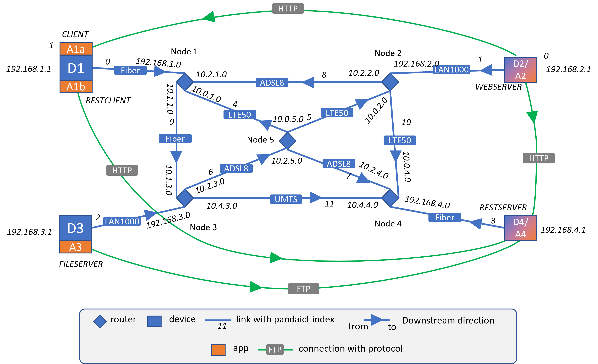

.. 	@author: jringelstein	
.. _ip_support:

###################################
IP addresses and IP routing support
###################################

The IP protocol is widely used in ICT networks, thus it has special support in pandaict. You can assign IP addresses to devices and 
router-type nodes, define static IP routing and automatically calculate routing tables. There is a small class for handling IP addresses.
Support is currently limited to IPv4, though.  

Limitations and modeling rules
==============================

At the moment, IP support is early-version and has the following limitations: 

- Limitation to **IPv4 only**. IPv6 is unsupported as of now. 
- Routing tables are only calculated for router-type nodes, **not for devices**.
- There is no differentiation between local and wide area networks for router-type nodes. The effect of this is that in order to do routing table calculation, devices must be assigned **unique IP addresses**. Two devices in different LAN subnets having the same IP (e.g. 192.168.0.1) is currently unsupported. 

This means that modelling IP networks needs to be done very carefully in terms of IP address and netmask definition, especially when there is a high amount of subnets. 
Also, ports of router-type nodes are implicitely defined. Each port of a router-type node is represented by an entry in the node's link_types list. 
The node's IPs and associated netmasks are given as lists with the same length of link_types, hence defining the router ports and associated IP addresses. 
This also means that the link_types list might contain the same linktype multiple times.   

.. note:: Please refer to test/core_test.test_ip_support for an example on IP network creation and routing table calculation. The modeled testnet is this: 

		
Functions
=========

You can find detailed information in the following documentation:

.. toctree::
    :maxdepth: 1

    ip_support/ip_address
    ip_support/ip_support

   
 